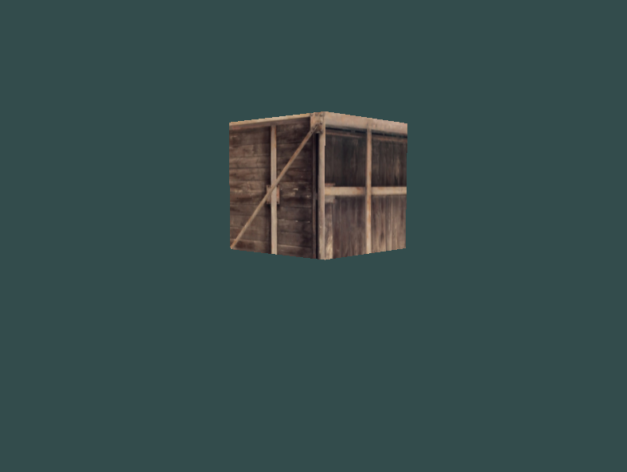

# Screenshot



# Features
- OpenGL-based 3D renderer

- Object rendering
    - Common data is shared in GPU
    - Assimp is used to load mesh into the Engine
    - Scenes are modifiable   

- Gravity

- FPS-style Movement

# Planned Features
- Collision
- Shooting
- Lightning System
- Material System
- Scene Builder
- Scene Loader
- Multithreading
- GUI

# Development Notes
- Currently, the project is in really early phase of development.

# Compilation
- The compilation currently works only on Fedora

Requirements
- Compiler & CMake:
    - G++ 15.3, CMake 3.2+
- Graphics & Windowing:
    - OpenGL 4.6, GLAD, GLFW3   
- External Files Loading:
    - Assimp, STB Images

- Missing Components
    1) If CMake is missing:
        ```bash
        sudo dnf install cmake
        ```

    2) If OpenGL is missing:
        ```bash
        sudo dnf install mesa-libGL-devel mesa-libEGL-devel
        ```

    3) If GLFW is missing:
        ```bash
        sudo dnf install glfw-devel
        ```

    4) If Assimp is missing:
        ```bash
        sudo dnf install assimp-devel
        ```

Compilation Process 
- For this to work, you have to be in the root folder of the repository (game-engine-fps)  
    1) Enter the build folder
        ```bash
        cd build/
        ```
    2) Generate the Makefile  
        ```bash
        cmake ..
        ```
    3) Execute the Makefile
        ```bash
        make
        ```
    4) Execute the generated binary
        ```bash
        ./gameengine
        ```